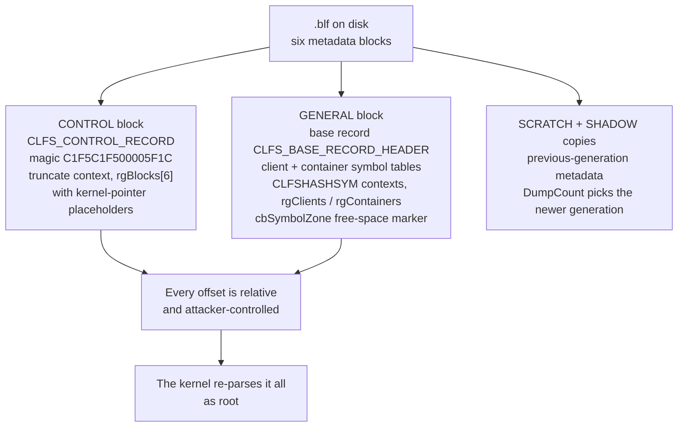

If you had to bet on a single Windows component to be privilege-escalated this year, the smart money has been on the Common Log File System driver for four years running. Since 2018 Microsoft has patched more than thirty CLFS elevation-of-privilege vulnerabilities. Between 2022 and 2025, six of them were exploited in the wild, four as zero-days, almost all by ransomware operators, with two end-to-end chains documented publicly down to the pool sprays and the token overwrites. October's Patch Tuesday added three more: CVE-2026-70233, CVE-2026-85870, and CVE-2026-85355, all elevation of privilege, none exploited, and, one week post-patch, precisely zero public technical analysis of any of them.

That absence is the excuse for this post. What follows is the CLFS design flaw explained from the disk format up, the exploit history that made the driver famous, a verified static patch diff of the October fix (including the honest post-mortem of how modern Microsoft update packaging tries to stop exactly this kind of diff, and the workaround that beat it), and the frontier-closing mitigations that give the first real reason to believe the farm is being fenced off. A correction to the week's rumor mill is included at no charge: there was no exploited CLFS zero-day this month. The one exploited bug in October's release is CVE-2026-96951, a Windows Shell issue covered in [its own post](/2026/10/19/motw-endgame-cve-2026-96951/); all three CLFS bugs are unexploited per Microsoft, ZDI, Talos, and Qualys alike.

## The Design Flaw That Keeps Paying

`clfs.sys` is a kernel-mode logging subsystem that has shipped since Vista, and its on-disk format, the base log file or `.blf`, is best understood as something no secure code reviewer would approve in a vacuum: **a dump of kernel structures, including raw kernel-pointer placeholders, written to a file the user controls, and read back and trusted by the kernel.** The reference reverse-engineered documentation is Alex Ionescu's clfs-docs; everything below leans on it plus the public exploit teardowns from PixiePoint, Zscaler, CoreSecurity, Kaspersky, and Qianxin.

The layout, briefly, because the bug class will not make sense without it:


<span class="fig-cap">Fig 1: the base log file. The SHADOW copies exist for crash recovery; exploits abuse them to keep corrupted structures "consistent" across generations.</span>

Each metadata block carries `RecordOffsets[16]` and a `SignaturesOffset`; the driver overwrites the last two bytes of every 0x200-byte sector with a sector number, relocating the original bytes into the signature area. Offsets are relative to block start. The base record holds two symbol tables, clients and containers, whose contexts are wrapped in `CLFSHASHSYM` headers; some driver functions blindly subtract a dozen bytes from a context pointer to reach the assumed header. And the container context holds `pContainer`, a placeholder for the kernel `CClfsContainer` object pointer that the driver fills in at runtime.

That last sentence is the whole disease. Kaspersky's cross-exploit analysis of five ransomware CLFS exploits made the operational point that matters: a freshly created `.blf` has a *fixed layout*, so real exploits do not ship a crafted file at all. They call `CreateLogFile`, let the OS build the structure, and then patch a handful of bytes at hardcoded offsets. The exception handlers inside clfs.sys swallow access violations during parsing, which plausibly explains why fuzzers kept missing this entire class. The kernel parses a user-writable file as root, the attacker knows the exact byte offsets, and the error handling suppresses the crashes. That is not a vulnerability; that is an API.

## Six Exploited Bugs in Four Years: The Receipt Trail

The history is unusually well documented, which is why CLFS is the best case study in Windows LPE economics.

**CVE-2022-24521** (April 2022, reported by the NSA and CrowdStrike) is the perfect teaching example because PixiePoint's teardown shows the whole recipe: create a fresh log, patch five values, and point `rgClients[0]` at a forged client context overlapping the kernel-pointer placeholder. The driver *caches* the attacker's fake value on open; `LoadContainerQ` overwrites it with a real `CClfsContainer*`; then `FlushMetadata` restores the cached fake on close, feeding an attacker-chosen address into `ObDereferenceObject`. Arbitrary QWORD decrement, drilled into `KTHREAD.PreviousMode` (1 to 0, Tarjei Mandt's 2011 technique), and from there full user/kernel read-write via the `NtReadVirtualMemory`/`NtWriteVirtualMemory` self-tank. Microsoft's fix introduced `ValidateRgOffsets`, the birth of modern CLFS hardening.

**CVE-2022-37969** (Zscaler's two-part teardown) established the truncate/symbol-zone class: mis-validation of `cbSymbolZone` lets a fake container context be planted at a controlled offset, again yielding `pContainer` control.

**CVE-2023-28252** is the one that made the news: the Nokoyawa ransomware zero-day, eighty percent junk-code-obfuscated, used across retail, energy, manufacturing, and healthcare on three continents. Qianxin's analysis of the in-the-wild sample showed an out-of-bounds *increment*: corrupted control-record fields made `ExtendMetadataBlock`/`WriteMetadataBlock` index past the six-entry block array, and the resulting OOB read-plus-increment bumped `rgContainers` so the symbol lookup returned attacker memory. The privilege-escape chain that followed (`PoFxProcessorNotification` → `ClfsMgmtDeregisterManagedClient` → `ClfsEarlierLsn` → `SeSetAccessStateGenericMapping`) became the template for a generation of Windows LPE write primitives.

Kaspersky's most interesting observation is economic: the five ransomware exploits share debug strings and code style, pointing to a **single exploit author servicing multiple crews**. Ransomware syndicates buying APT-grade zero-days from one artisan, and the product was this driver, over and over.

The drumbeat continued after the famous ones: CVE-2024-49138 (December 2024, the month's only zero-day, confirmed exploited), CVE-2025-32701 and CVE-2025-32706 (both exploited, both KEV, May 2025), and the best-documented chain of all: **Storm-2460, April 2025**, where Microsoft documented CVE-2025-29824 being delivered through the PipeMagic loader (an MSBuild inline-task dropper fetching payload via certutil), executed in memory from `dllhost.exe`, dropping its crafted log to `C:\ProgramData\SkyPDF\PDUDrv.blf`, escalating via an `RtlSetAllBits` token overwrite, dumping LSASS, and deploying RansomEXX. One footnote in that report matters for this post's ending: Windows 11 24H2 was *not* exploitable via that technique, because the classic kernel-address leak it relied on now requires SeDebugPrivilege.

A non-EoP sidebar rounds out the picture: Google's PRIVATELOG/STASHLOG research found malware *storing payloads inside CLFS log files* because nothing in the defensive stack inspected the format. The log became a hiding place before it finished being a launchpad.

## The October Trio

Against that history, October's three new bugs (all "Windows Common Log File System Driver Elevation of Privilege Vulnerability", all affecting every supported Windows client and server SKU) read as follows, straight from Microsoft's CVRF feed:

| | CVE-2026-70233 | CVE-2026-85870 | CVE-2026-85355 |
|---|---|---|---|
| Class | Heap buffer overflow (CWE-122) | Heap buffer overflow (CWE-122) | **Untrusted functionality inclusion (CWE-829)** |
| CVSS 3.1 | **7.8**, `AV:L/AC:L/PR:L/UI:N` | 7.0, `AV:L/AC:H` | 7.0, `AV:L/AC:H` |
| Credited | Divya Sundar (with MSRC V&M) | r3con, developer-commit, hw4yeon, ZeroBig27380, step_jo, j_any0 (a Korean research cluster) | anonymous (a hash as the name) |
| Exploited | No; EPSS ~0.4% | No | No |

Two rows deserve commentary. First, **70233 is the stand-out**: the only one rated attack-complexity Low, and the only one Cisco Talos wrote network rules for (Snort SIDs 1:67302 and 1:67303, with 3:301709 in the Snort 3 set). The rule documentation is explicit about what they match: bytes "specific to files that are intended to exploit" the vulnerability. Read that again, because it defines the detection model for this whole class: **the signatures match the malicious `.blf` file's static byte patterns, not any network exploit behavior.** CLFS attacks are file-delivered local attacks, so your detection opportunity is wherever files cross a boundary you can inspect: mail gateways, archive-scanning paths, EDR file events. A crafted log file is a weapon with a fingerprint.

Second, **CVE-2026-85355's CWE-829**, "inclusion of functionality from an untrusted control sphere", has no public precedent in this driver, and as far as I can find in kernel drivers generally; the adjacent classes are normally untrusted-search-path bugs (CWE-426/427). Nothing in Microsoft's bulletin text explains what CLFS could be "including" from an untrusted sphere. My best guess (flagged as a guess) is the driver following attacker-supplied paths or handles to load or execute something outside its trust boundary, which, if true, would be evidence that the older bug classes are closing and pushing research into genuinely new shapes. Until someone publishes root cause, that is where it has to sit.

The honest state of the world one week post-patch: no root-cause analysis, no PoC, no patch diff published by anyone for any of the three. Which is what I was doing all week.

## The Patch Diff

Since the fix is in `clfs.sys` itself, the diff is the ground truth. Getting the binaries is the whole game, and modern Microsoft packaging is designed to stop you. Documented honestly, because the method matters more than the result:

The October Windows 11 24H2 cumulative is KB5127648 (build 26100.9711), the final 24H2 update ever; September's is KB5124008 (26100.9445). Microsoft's own file-information CSVs for the two KBs give ground truth before any download: `clfs.sys` x64 changed from **10.0.26100.9278** (570,848 bytes) to **10.0.26100.9711** (585,080 bytes, plus 14,232). The driver itself changed, so the CLFS fixes live here.

I downloaded and extracted the October MSU (4.66 GB): the 2026-format update is no longer a cab-of-cabs but a WIM containing an SSU cab, a DesktopDeployment cab, and the payload as a 2.39 GB `.psf` file with magic `PSTREAM`, Microsoft's express-payload container that no Linux tool opens; only Windows' CBS applies it. Classic PSFX double-cab extraction is dead for current builds. The workaround: **winbindex**, m417z's index of Windows binaries by SHA256, which constructs Microsoft Symbol Server URLs. Both hashes from the KB CSVs were present, and the symbol server returned both authentic binaries:

```
clfs.sys 10.0.26100.9278  570,848 B
  sha256 3BC0C50AE8021EA49ACE07CF617CE7E84A7B3B2DE29284DBA1537DC6550EC441
clfs.sys 10.0.26100.9711  585,080 B
  sha256 A257473339E66C0321B98224CF917263E869424EF7DCEA7636F6BED977796D3C
```

Both files hash-verified exactly against the KB manifests, so this is a diff of genuine Microsoft-shipped files. The results:

- The two binaries are a **full compiler rebuild** (about 79 percent of bytes differ, in 993 merged regions), so byte-level comparison is meaningless without BinDiff-class tooling, which this Linux box does not have. What the PE structures still say is the story.
- `SizeOfImage` grew one page. Section deltas: `.text` **plus 496 bytes**, `PAGE` **plus 792 bytes**, `.pdata` plus 144 bytes of raw unwind data (roughly one new function-level entry), `.rdata` plus 224, `.data` plus 32, `.reloc` plus 64; `.idata`, GFIDS, `.edata`, and `INIT` unchanged. Reading it plainly: **roughly a kilobyte of new or modified executable code across a handful of functions**, which is the signature of added validation checks, not a rewrite, and plausibly three fixes plus a shared validation helper landing in one rebuild. I want to be precise about the limit of this method: the section arithmetic shows the *shape* of the fix. Attributing specific added checks to specific CVEs requires disassembly with diffing tooling, and I did not run one.
- Strings are silent: the only code-string change is one C++ mangled name (`CClfsContainer` destructor form). Every other new byte is the Authenticode overlay; the signing chain moved from Windows Production PCA 2011 to the 2023/2026 PCA with RFC3161 timestamps dated October 9 through 11. The new validation code ships with no diagnostics, no event log strings, nothing a defender can see at runtime.
- A pleasant aside for incident responders: both builds carry a `fothk` section of kernel hotpatch thunks. Microsoft can hotpatch this driver out-of-band, which is exactly what you would do if one of these three turned out to be exploited after all.

So the October fix, verified: ~1 KB of silent validation code in a 585 KB driver, guarding a parser that trusts a user-writable file's offsets and pointer placeholders, against three new ways to abuse it, in the most farmed LPE surface in Windows.

## The Frontier Is Closing, Slowly

The reason to believe the CLFS era is ending is not the October patch. It is two structural changes.

First, the **CLFS Authentication Mitigation** (shipped with October 2025-era updates for current builds): per-file HMACs computed with a system-unique registry key, verified at open *before any parsing*, with failure returning `STATUS_LOG_METADATA_CORRUPT`, plus `.cnpf` recovery files, a 90-day learning mode, and a documented ~2x record-write slowdown as the price. This converts the entire craft-a-`.blf` bug class, everything in the receipt trail above, into "first defeat a keyed MAC on the target system." Second, Windows 11 24H2 removed the classic kernel-address leak that every 2022-2023 exploit used as stage one, which is exactly why Storm-2460's April 2025 chain skipped 24H2.

Put those next to October's trio: three new bugs, two rated attack-complexity High, none exploited a week in, rules covering the file signatures, on builds where the old chain prerequisites are gone. Six exploited bugs in four years was the receipt trail; the October trio is the first cohort to land on a closing frontier. The open question that makes this worth revisiting: if someone publishes root cause on the CWE-829 bug and it turns out the driver is following untrusted pointers to outside functionality, that is not a leftover from the old class; that is evidence the hardening itself is rerouting attacker creativity into new ground. Watch that one.

## Appendix: Reference

**The three CVEs (all: every supported Windows SKU, EoP, not exploited, not in KEV, EPSS under 0.4%):** CVE-2026-70233, heap overflow, CVSS 7.8 `AV:L/AC:L/PR:L/UI:N/S:U/C:H/I:H/A:H`, Talos Snort 1:67302 / 1:67303 / 3:301709; CVE-2026-85870, heap overflow, 7.0 `AC:H`; CVE-2026-85355, CWE-829 untrusted functionality inclusion, 7.0 `AC:H`. Fixed in the October 2026 cumulative (24H2: KB5127648, build 26100.9711) across all SKUs; the exploited bug that month was the unrelated Windows Shell CVE-2026-96951.

**The diffed pair:** `clfs.sys` 10.0.26100.9278 (570,848 B, sha256 `3BC0C50AE8021EA49ACE07CF617CE7E84A7B3B2DE29284DBA1537DC6550EC441`) versus 10.0.26100.9711 (585,080 B, sha256 `A257473339E66C0321B98224CF917263E869424EF7DCEA7636F6BED977796D3C`), both hash-matched against Microsoft's KB file manifests and fetched via winbindex-constructed symbol-server URLs. Delta: full rebuild; `.text` +496 B, `PAGE` +792 B, `.pdata` +144 B raw, sections after `.pdata` shifted one page; signing chain PCA 2011 → PCA 2023/2026.

**Methodology note, for anyone repeating this:** the modern MSU is a WIM whose LCU payload is a `PSTREAM`-magic `.psf` that no Linux tool applies (PSFX delta-patching requires Windows CBS). The reproducible Linux path is: KB file-information CSV for ground-truth hashes → winbindex → `msdl.microsoft.com/download/symbols/<name>/<timestamp-hex><SizeOfImage-hex>/<name>` → hash-verify. September's MSU (4.64 GB) was not downloaded once the symbol-server path was proven; total transfer for the working method was one MSU plus two small binaries.

**The exploit-history shelf:** CVE-2022-24521 (PixiePoint; NSA/CrowdStrike report; `ValidateRgOffsets` born), CVE-2022-37969 (Zscaler; symbol-zone class), CVE-2023-28252 (Kaspersky/Qianxin/CoreSecurity; Nokoyawa zero-day; OOB increment chain), CVE-2024-49138, CVE-2025-29824 (Storm-2460, PipeMagic, `PDUDrv.blf`, `RtlSetAllBits`), CVE-2025-32701/-32706/-30385/-32713; PRIVATELOG/STASHLOG for log-files-as-hiding-place; Kaspersky's five-exploits series for the single-author economics and the exception-handler insight.

**Corrections and citations:** everything structural cites Ionescu's clfs-docs, Securelist, PixiePoint, Zscaler, CoreSecurity, and the ZDI/Trend Micro Black Hat Asia 2022 talk. I could not verify the existence of an IBM X-Force CVE-2023-28252 teardown or a Yarden Shafir CLFS publication that circulate as citations in other writeups; I recommend the sources above instead. Corrections welcome, as always, and if you get a Windows lab on the 9278-versus-9711 pair before I do, the function-level diff of those 1,288 new bytes is the post I would most like to read.