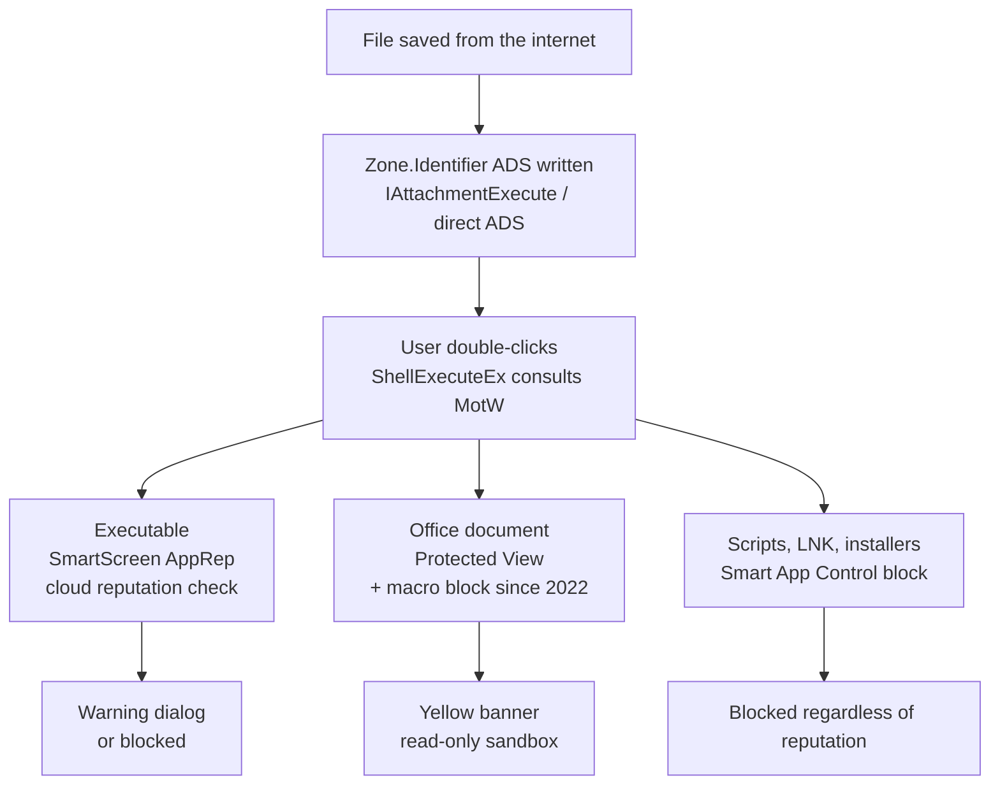

October's Patch Tuesday set every record that exists: 1,413 vulnerabilities, Microsoft's first four-digit month, roughly 45 percent above September's record, more fixes than any previous full year, with the year-to-date total crossing 4,000 CVEs with two months still on the clock. Sixty-ish of the CVEs are wormable under ZDI's definition. And exactly one of them was exploited in the wild: CVE-2026-96951, a Windows Shell security feature bypass, rated Important, CVSS 8.8, added to the KEV catalog the day it shipped with a three-day federal deadline.

The exploited bug being Important rather than Critical is the tell. This is not a remote kernel heap overflow; it is a command injection in Windows Shell whose effect, per Microsoft's description, is that "a security feature" gets bypassed. That feature is the Mark-of-the-Web. If an attacker strips MotW from a downloaded file, nothing downstream ever asks the scary question: no SmartScreen "Windows protected your PC", no Office Protected View, no macro block, no App Guard. The payload runs like a file the user created themselves.

This post is the anatomy of that trust chain and the four-year campaign to break it, because 96951 is not an isolated bug; it is the endgame of a perfectly predictable arc. One caveat up front, and it matters: a week after the patch, no public analysis, PoC, or patch diff of 96951 exists. Which Shell component mis-handles which string is unpublished. Everything here about the bug itself is framed accordingly, and everything about the ecosystem around it is documented fact.

## What Mark-of-the-Web Actually Is

Strip the marketing and MotW is one NTFS alternate data stream. When a supported client saves a file from the internet, it writes a second stream onto the file named `Zone.Identifier`, containing, in its minimal and canonical form:

```
[ZoneTransfer]
ZoneId=3
```

ZoneId maps to the URLMON security zones: 0 is My Computer, 1 local intranet, 2 Trusted sites, 3 Internet, 4 Restricted. Fuller records can carry `HostUrl=` and `Referrer=` provenance lines, which is what forensic tooling keys on; Sysmon's Event ID 15 (`FileCreateStreamHash`) exists precisely to capture this stream's creation and content. You can read one with `notepad.exe invoice.docx:Zone.Identifier` or `dir /r`.

The writer side is the part most people get wrong. The contract is URLMON's `IAttachmentExecute` interface: Chrome saves through `IAttachmentExecute::Save`, Firefox writes the ADS directly. And `Save` has a subtle, load-bearing rule: the ZoneId written is the *least-privileged* zone calculated across the source URL and the referrer, under a MotW-specific ordering where a Trusted-zone download with no referrer writes no MotW at all. Outlook tags attachments on double-click or Save As, and, in a gap that was never fully closed, historically failed to tag on drag-and-drop.

Reading is where the security actually lives. `ShellExecuteEx` consults MotW; plain `CreateProcess` ignores it entirely, which already tells you the trust check lives in the shell layer, not the kernel. Three big consumers branch from that one check:


<span class="fig-cap">Fig 1: the entire user-facing security model for downloaded files hangs off one alternate data stream and one shell-level check.</span>

SmartScreen has its own post-check bookkeeping worth knowing for forensics: Edge originally wrote an `AppZoneId=4` line into the same stream after a clean reputation pass, moved it in March 2022 to a separate `:SmartScreen` stream containing the text `Anaheim` (Edge's codename), and since February 2023 Windows 11 removes the Zone.Identifier stream entirely after a successful check. One stream, three eras, all examinable on disk.

## 2022: The Battleground Moves to Propagation

The first phase of the endgame targeted not the check but the *write*. If your dropper is inside a ZIP, the question becomes: does the extracted payload inherit the archive's MotW? In November 2022 Microsoft extended Windows' archive handling to propagate the stream into extracted files, and the patch window immediately produced CVE-2022-41049 (crafted ZIP/tar archives whose contents extracted without the marker) and its companion CVE-2022-41091, exploited in the wild by Magniber ransomware via crafted ISO containers. The pattern for the next four years was set: wherever a writer or extractor forgets to propagate the stream, the whole downstream stack silently stands down.

Third-party tools became a cavity search. A June 2026 forensics piece on the rules change documented the mechanics: urlmon's `CZoneIdentifier::Load` now, on finding no `Zone.Identifier` stream, walks to the *container file* behind a mounted virtual drive (via virtdisk.dll's storage-dependency API) and checks its stream instead, because Microsoft cannot write an ADS onto a FAT32 volume, and if they could, campaigns would simply switch to FAT32. Tools that kept checking only the extracted file itself produced a slow-motion CVE pile: CVE-2025-33027, CVE-2025-50328, CVE-2025-46652, CVE-2025-33028, CVE-2026-58052, CVE-2025-31334, plus in-the-wild CVE-2024-38217.

The elegant one is worth a paragraph of its own, because it is the purest expression of the ADS as attack surface: 7-Zip's guard against archive-supplied `Zone.Identifier` streams matched the stream name exactly, so a crafted RAR5 record named `:Zone.Identifier:$DATA` sailed past the check, and NTFS canonicalized it to the very same stream, overwriting the propagated marker with ZoneId=0, My Computer. The defender's own stream, forged by the archive. That is CVE-2026-58052, patched in 7-Zip 26.01.

## 2024: From Stripping the Marker to Defeating the Check

Once propagation hardened, attention moved to the check itself. February 2024 delivered CVE-2024-21412, an internet-shortcut SmartScreen bypass exploited as a zero-day by two very different customers: Water Hydra, an APT that targeted financial-market traders with it chained to the DarkMe loader, and the DarkGate operation, which used it in fake-software-installer campaigns so its loader would run without the warning dialog. McAfee separately documented DarkGate abusing a *signed* AutoHotkey binary for the same purpose. August 2024 added CVE-2024-38213, "Copy2Pwn", a copy-paste-based MotW bypass that reached the KEV catalog and was still being used for SmokeLoader distribution in March 2025, and CVE-2024-38217, "LNK Stomping".

Then 2025's archive-tool zero-day: CVE-2025-0411, a 7-Zip double-nesting bug used against Ukrainian organizations to deliver SmokeLoader, with follow-on ZIP variants CVE-2025-11001 and -11002. Kaspersky tracked ScarCruft developing MotW-evading infection methods in parallel.

## 2026: The Shell Itself Becomes the Target

This year the arc reached its logical conclusion, and it is the part of the record that makes 96951 feel inevitable rather than surprising. In December 2025, APT28 began exploiting CVE-2026-21510, a zero-click LNK-parsing flaw in Windows Shell; the February 2026 fix was incomplete, and the re-patched CVE-2026-32202 was exploited again in April, including against Saudi financial-sector targets with NTLM hash theft. Weeks later, Pawn Storm's PRISMEX campaign was documented using CVE-2026-21513, an MSHTML security-features bypass, to defeat MotW and IE Enhanced Security Configuration against the Ukrainian defense supply chain. Three state-grade campaigns, all inside the Shell and its rendering stack, all hunting the same trust boundary.

Which brings us to the October bug. CVE-2026-96951 is filed as CWE-77, command injection, in Windows Shell, remotely triggerable with user interaction: a crafted file arrives by email, messaging, or download, the user opens it, and somewhere in the Shell's handling of it attacker-controlled special elements reach command interpretation, and the security-feature check does not happen. That CWE choice is the only real technical clue published so far, and it invites an obvious family of theories (some Shell code path handing a filename, shortcut field, or verb string to command interpretation without neutralization), but no researcher has published one, and I will not dress speculation up as analysis. What the record does establish: it is the third exploited Windows Shell flaw of 2026, the two predecessors were APT28's, Microsoft credits four finders, does not say which submission corresponds to the in-the-wild activity, and a week post-patch there is no public PoC, no attribution, and no IOCs.

One credit deserves its own paragraph, because it may be a first. The four finders are Riku Bamba and Yuya Chudo of Fujitsu, a researcher listed only as "yhw", and, verbatim from Microsoft's acknowledgement, **"Benoit Sevens using Claude with Anthropic"**. Sevens is a Google Threat Analysis Group researcher with Apple zero-days on his record. Anthropic's credited-CVE census (VulnCheck's April 2026 survey of Project Glasswing output: Firefox, wolfSSL, OpenSSL, FreeBSD) contained no Microsoft entries at the time, so this appears to be the first AI-assisted credit in an MSRC security bulletin, though I present that as an inference from the public census rather than a claim Microsoft has made. Microsoft's own comment, quoted verbatim: "As AI-assisted research contributes to vulnerability discovery, this kind of approach may become more useful." How Claude was actually used in the find is undocumented. What is not undocumented is the outcome: an AI-assisted find, from a rival company's researcher, is now an actively exploited bug that federal agencies had seventy-two hours to patch.

## What Actually Defends When the Marker Is Gone

The consistent theme of every analysis worth citing: MotW and user awareness are explicitly not sufficient compensating controls anymore, because the bug class is "remove the flag the controls key on." What remains, roughly in order of how much I would trust them:

**Trust nothing about file origin; trust signatures and prevalence.** Smart App Control blocks ShellExecute of script, LNK, and installer extensions based on code identity and cloud prevalence, never consulting MotW. WDAC (App Control for Business) allowlists by signature. Both are indifferent to whether the Zone.Identifier survived, which is precisely why they survive this bug class.

**ASR rules that never read the stream.** "Block all Office applications from creating child processes" and "Block executable files unless they meet a prevalence, age, or trusted list criteria" fire on behavior, not provenance. The standard deployment rhythm applies: Audit for two to four weeks, then review the ASR report before enforcing.

**Telemetry that watches the stream instead of trusting it.** Sysmon Event ID 15 captures Zone.Identifier creation and content (a file arriving *without* the stream it should have is now itself interesting); SmartScreen's ETW providers expose a `MarkOfTheWeb` field on evaluation events; and the behavioral hunt for 96951-era activity is the one SOC Prime published: unexpected child processes from Explorer or document apps, script interpreters spawned from downloaded content, execution from user-writable directories, plus retrospective review of every pre-patch attachment and download. Atomic Red Team ships four T1553.005 emulations if you want to test your coverage honestly.

**And the ugly gap, verbatim from Rapid7:** "Windows Server 2012 doesn't receive a patch, although Server 2012 R2 does." Non-R2 2012 remains exposed to an actively exploited bypass with no fix available at any price, and the entire 2012/2012 R2 ESU program ended this month.

## The Same-Tuesday Chain Kit

For completeness, the rest of the October release reads like the other two links of a classical intrusion chain waiting for their MotW strip: five Critical Outlook RCEs at 9.8 (CVE-2026-70242, -70291, -88156, -97016, -97749), two of them triggering through the preview pane with no click at all, the CVE-2023-23397 successor class revived; CVE-2026-96913, a Windows kernel heap overflow at 8.8, the natural sandbox-escape partner for a document-rendering bug; and two Hyper-V guest-to-host escapes (CVE-2026-102214, -105733, both 8.8) for the isolation finale. I document the trio here as anatomy, not as a claimed observed chain; nothing in the record connects them to 96951 in the wild. But if you want to know what a complete 2026 Windows intrusion looks like on paper, Microsoft shipped all the pieces in one download this month.

## Closing Argument

The four-year arc has a shape you can draw in one line: attackers went from stripping the marker (archives, containers, LNK stomping), to defeating the check (SmartScreen bugs), to corrupting the marker's handler from inside the Shell (96951). Each stage attacked the trust chain one layer deeper, and the endgame layer, Shell command injection, is the one where the fix has to live in the most exposed, most backward-compatible code Microsoft ships. ZDI's framing is the right one: attackers have been bypassing MotW since 2024, and the result is always the same, so the control you should be engineering for is the one that does not care whether the marker exists.

For defenders, that means SAC, WDAC, and MotW-independent ASR rules are no longer hardening extras; they are the controls that keep working on the days this class lands. For researchers, two open questions are worth watching: the patch diff of 96951, which will name the component once someone with a Windows lab does the work, and whether the Anthropic credit becomes a regular MSRC column. If bug discovery scales with AI the way Microsoft hints, the four-digit Patch Tuesday is not the new normal; it is the floor.

## Appendix: Quick Reference

**The bug:** CVE-2026-96951, Windows Shell security feature bypass, CWE-77 command injection, CVSS 3.1 8.8 (`AV:N/AC:L/PR:N/UI:R/S:U/C:H/I:H/A:H`), Important. Exploited in the wild per Microsoft; KEV added 2026-10-13, federal due 2026-10-16; no attribution, no IOCs, no public PoC or patch analysis as of 2026-10-19. Affects Windows 10, all Windows 11, Server 2012 R2 through 2025 (non-R2 2012 unpatched); Outlook.com fixed service-side. Reporters: Riku Bamba, Yuya Chudo (Fujitsu), "yhw", Benoit Sevens (using Claude, with Anthropic).

**The bypass lineage, compressed:** CVE-2022-41049 / -41091 (archive and container propagation, Magniber) → CVE-2024-21412 (SmartScreen via internet shortcut; DarkGate, Water Hydra/DarkMe) → CVE-2024-38213 Copy2Pwn, CVE-2024-38217 LNK Stomping → CVE-2025-0411 (7-Zip, SmokeLoader, Ukraine) → CVE-2026-58052 (7-Zip RAR5 stream forgery, `:Zone.Identifier:$DATA` → ZoneId=0) → CVE-2026-21510 / -32202 (APT28 zero-click Shell LNK, incomplete patch, NTLM theft) → CVE-2026-21513 (MSHTML, Pawn Storm PRISMEX) → CVE-2026-96951 (Shell command injection, unknown actor).

**Detections:** Sysmon EID 15 (`FileCreateStreamHash`); SmartScreen ETW GUIDs `3cb2a168-fe34-4a4e-bdad-dcf422f34473` (EID 1000, `MarkOfTheWeb` field) and `6eca6717-a528-4bde-ae82-a924b29cd2a4` (TraceLogging); behavioral hunts per SOC Prime (Explorer/document-app childprocs, interpreters from downloaded content, user-writable-dir execution); MITRE T1553.005 with four Atomic Red Team emulations.

**Controls that do not read the marker:** Smart App Control; WDAC/App Control for Business; ASR rules "Block all Office applications from creating child processes" and "Block executable files unless they meet a prevalence, age, or trusted list criteria"; attachment-manager GPO extension lists; executable-content filtering at the mail gateway.

Corrections welcome. If you are still running Server 2012 non-R2 in anything internet-facing, the patch status of this bug is the least of your problems, but it is the one with a deadline that already passed.
